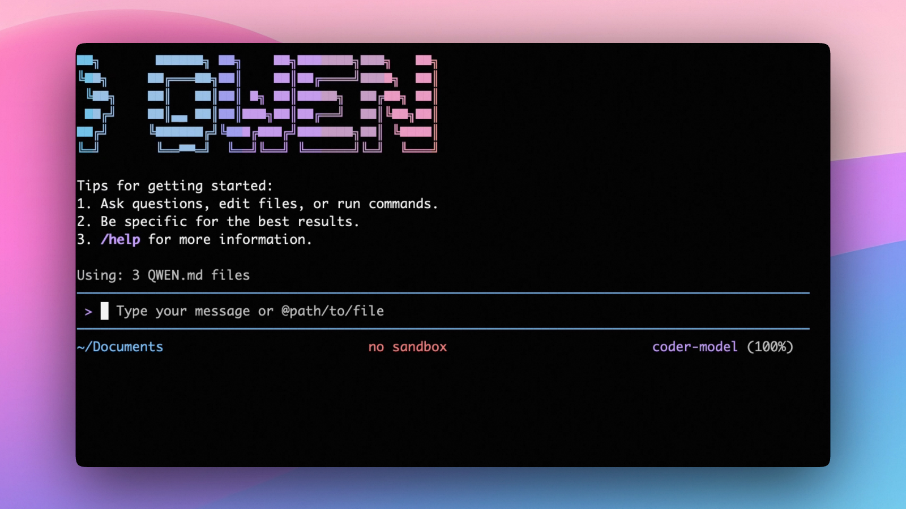

# Qwen Coder Minimal

**A security-hardened, telemetry-free build of [Qwen Code](https://github.com/QwenLM/qwen-code) `v0.25.1`.**

Qwen Coder Minimal is a fork of the upstream Qwen Code CLI, trimmed down to just
the terminal CLI. It keeps all of the AI coding
features intact while removing every non‑model network call and the accompanying
configuration, and its runtime dependencies are patched to **zero `npm audit`
vulnerabilities**. On top of upstream it also adds a few **local, offline**
enhancements — see [What this fork adds](#what-this-fork-adds).

### What's different from the original Qwen Code

| Area                         | Upstream Qwen Code                                                                       | Qwen Coder Minimal                                                                                                                                               |
| ---------------------------- | ---------------------------------------------------------------------------------------- | ---------------------------------------------------------------------------------------------------------------------------------------------------------------- |
| Usage telemetry (Aliyun RUM) | Enabled by default, sends usage events                                                   | **Removed** — no usage data ever leaves the machine                                                                                                              |
| OpenTelemetry / OTLP export  | Optional traces/logs/metrics exporters                                                   | **Removed** — exporters, `@opentelemetry/*` SDK deps, and all telemetry config/flags deleted                                                                     |
| Update / version checks      | Pings the npm registry + auto-updates on startup                                         | **Removed** — no background version checks, no self-update                                                                                                       |
| Plugin marketplace           | Installs extensions from GitHub marketplace / git / npm                                  | **Removed** — extensions install from a **local path only**                                                                                                      |
| Messaging channels           | Telegram / WeChat / DingTalk / Feishu integrations                                       | **Removed**                                                                                                                                                      |
| Qwen OAuth login             | Built-in OAuth sign-in (free tier, discontinued upstream)                                | **Removed** — authenticate with an API key                                                                                                                       |
| Alibaba Cloud Coding Plan    | Built-in subscription provider                                                           | **Removed** — use any API-key provider                                                                                                                           |
| Model providers & auth       | OpenAI, Anthropic, Gemini, Vertex AI, plus DashScope / OpenRouter / Fireworks AI presets | **OpenAI-compatible API key only** (Anthropic, Gemini, Vertex AI, DashScope, OpenRouter and Fireworks removed)                                                   |
| UI languages                 | 9 bundled locales                                                                        | **English and Russian only**                                                                                                                                     |
| Editors & SDKs               | VS Code, Zed, JetBrains, a desktop app, TS/Python/Java SDKs                              | **Terminal CLI only** (VS Code/Zed extensions, desktop app, and all SDKs removed; JetBrains and other editors can still connect over stdio ACP via `qwen --acp`) |
| Daemon mode (`qwen serve`)   | Local HTTP daemon (ACP over HTTP+SSE) for IDE / web / SDK clients                        | **Removed** — `qwen --acp` (stdio ACP) is kept                                                                                                                   |
| IDE companion (`/ide`)       | Terminal↔editor bridge (IDE native diffs, open-files context, workspace trust)          | **Removed**                                                                                                                                                      |
| Security (`npm audit`)       | Ships with known advisories                                                              | **0 vulnerabilities in runtime dependencies** (`npm audit --omit=dev`); dev-only tooling is kept current                                                         |

**Kept unchanged:** all core AI coding capabilities, local in-memory session
stats (token counts, footer, `/stats`), local extension installation, MCP
servers, skills, agents, and hooks. The only outbound traffic is to the AI model
provider you configure.

> Built from upstream `v0.25.1`. See [CHANGELOG.md](./CHANGELOG.md) for what
> each fork release added, changed and removed, and the git history for the
> exact commits.

### What this fork adds

Beyond the upstream feature set, this fork adds the enhancements below (no new
runtime dependencies beyond one pure-JS library). The **local** ones — memory
search, self-improving skills, and compaction self-healing — run entirely
on-machine with no new outbound traffic. Reasoning verification only calls the
provider you configure, and only when you ask for it. The optional model-hub
integration (model discovery and the load indicator) is described in
[Connecting a self-hosted model hub](#connecting-a-self-hosted-model-hub).

#### 1. Local full-text memory + transcript search

Auto-memory recall now queries a local [MiniSearch](https://lucaong.github.io/minisearch/)
index instead of linearly scanning ≤200 Markdown files. It searches the full
**body** of every memory file (not just titles/descriptions) and also indexes
your **past session transcripts** for the current project, surfacing relevant
prior exchanges under a `## Relevant past conversation` block. Transcript text
is secret-redacted before indexing, the index is persisted per-project, and any
error transparently falls back to the previous linear-scan behavior.

| Setting                                    | Default | Meaning                                     |
| ------------------------------------------ | ------- | ------------------------------------------- |
| `memory.searchIndex.enabled`               | `true`  | Master switch (off ⇒ exact previous recall) |
| `memory.searchIndex.includeTranscripts`    | `true`  | Index + retrieve past-conversation snippets |
| `memory.searchIndex.maxTranscriptSessions` | `50`    | Retention: newest N sessions                |
| `memory.searchIndex.maxTranscriptAgeDays`  | `90`    | Retention: max age                          |

#### 2. Self-improving skills (outcome-driven)

The auto-skill loop now **learns from how skills perform**. Each time an
auto-skill is used, the outcome is scored deterministically (helped / hurt /
neutral) from launch success and your next-turn reaction; failures store a
redacted evidence excerpt. At the next skill review the `managed-skill-extractor`
receives each skill's usage stats **and its specific failure evidence** and
rewrites the skill to fix those failures. Consistently-unhelpful auto-skills are
**reversibly deactivated** (moved to an unscanned `disabled-skills/` folder —
never deleted; move it back to re-enable). Hand-authored skills are never
modified or deactivated.

| Setting                                       | Default | Meaning                                                 |
| --------------------------------------------- | ------- | ------------------------------------------------------- |
| `memory.skillOutcomes.enabled`                | `true`  | Master switch (off ⇒ no tracking, no deactivation)      |
| `memory.skillOutcomes.useCorrectionHeuristic` | `true`  | Treat a next-message correction ("no", "wrong") as hurt |
| `memory.skillOutcomes.minSamples`             | `5`     | Min scored uses before a skill can be deactivated       |
| `memory.skillOutcomes.hurtRatio`              | `0.6`   | Hurt-ratio threshold for deactivation                   |
| `memory.skillOutcomes.maxEvidencePerSkill`    | `5`     | Retained failure excerpts per skill                     |

> Bundled **superpowers** process skills (brainstorming → writing-plans →
> subagent-driven-development, systematic-debugging, and more) ship by default at
> the `bundled` skill level, adapted from [obra/superpowers](https://github.com/obra/superpowers)
> (MIT © 2025 Jesse Vincent). Combined with `skills.enforceInvocation`, a fresh
> install proactively brainstorms before building. Override or disable per skill
> via `~/.qwen/skills/` or `.qwen/skills/`.

> **Plan-first write gate** (`skills.planFirstGate`, default on): on interactive
> sessions, `write_file`/`edit`/`notebook_edit` are blocked until the
> `superpowers:writing-plans` skill has run this session (the first file write
> of an interactive session triggers the gate) — a
> deterministic, model-independent guarantee that a plan exists before code is
> written, enforced in the tool scheduler rather than nudged via prompt (unlike
> `skills.enforceInvocation`). Writes under `docs/superpowers/` are always
> allowed, so the planning skills can save their spec and plan. At the prompt,
> choose **Yes** to skip planning and allow writes for the rest of the session,
> or **No** to stop and run planning first. It never fires in
> non-interactive/headless runs. During an active `superpowers:brainstorming`
> session where `superpowers:writing-plans` has not run yet, the gate
> **auto-redirects** instead of prompting — it denies the write with a message
> telling the model to run `superpowers:writing-plans`, so the plan is produced
> with no manual step (bounded to 2 auto-redirects, after which the Yes/No
> prompt returns so you can never be trapped). Disable it with
> `"skills": { "planFirstGate": false }`.

> **AskUserQuestion menu enforcement** (`skills.enforceAskQuestion`, default on):
> once `superpowers:brainstorming` has been used this session, on an interactive
> session, if the
> model poses a multiple-choice question as plain text instead of calling the
> `AskUserQuestion` tool, it is re-prompted to re-ask via the tool so the
> question renders as a native selectable menu — the deterministic analog of the
> plan-first gate for clarifying questions. Bounded to 2 re-prompts, after which
> the prose question stands; never fires in non-interactive runs. Disable with
> `"skills": { "enforceAskQuestion": false }`.

> **Writing-plans gate** (`skills.enforceWritingPlans`, default on): once
> `superpowers:brainstorming` has been used this session and
> `superpowers:writing-plans` has not, on an interactive session, if the model
> concludes a turn with a substantive declarative (non-question) message — a
> design sketch or "I'll implement" — it is re-prompted to invoke
> `superpowers:writing-plans` first, so a real written plan is produced before
> implementation. The proactive analog of the plan-first write gate. Bounded to
> 2 re-prompts (the plan-first write gate remains the reactive backstop for file
> writes); never fires in non-interactive runs. Disable with
> `"skills": { "enforceWritingPlans": false }`.

#### 3. Reasoning probe + picker in `/model`

Press **`r`** on a model in `/model` to configure its reasoning: choose
`enable_thinking` and a `reasoning_effort` level from a curated per-family list,
and optionally **Verify** — a handful of trial requests that badge which values
the live deployment actually accepts (✓ supported / ⚠ accepted-no-thinking /
✗ rejected / ? unknown). The pick is saved into the model's
`generationConfig.extra_body`. The curated list needs no network; Verify only
fires when you ask for it.

#### 4. Compaction self-healing

When an oversized or resumed session can't be shrunk by the normal LLM summary
compaction — for example the provider rejects the too-large summary request —
the fork now falls back to rule-based **fast compaction** (no model call) before
refusing to send, so a session that would otherwise be permanently wedged
recovers on its own. Purely local; also available manually as `/compress-fast`.

---

<div align="center">

[](./LICENSE)
[](https://nodejs.org/)

**An open-source AI agent that lives in your terminal.**

</div>

## Why Qwen Code?

Qwen Code is an open-source AI agent for the terminal, optimized for Qwen series models. It helps you understand large codebases, automate tedious work, and ship faster.

- **Flexible providers**: use any OpenAI-compatible API, or bring your own API key.
- **Open-source, co-evolving**: both the framework and the Qwen3-Coder model are open-source—and they ship and evolve together.
- **Agentic workflow, feature-rich**: rich built-in tools (Skills, SubAgents) for a full agentic workflow and a Claude Code-like experience.
- **Terminal-first, IDE-friendly**: built for developers who live in the command line, with optional integration for JetBrains and other ACP-compatible editors via `qwen --acp`.



## Installation

### Install from a release

Each [release](https://github.com/NeitrinoK/qwen-code-minimal/releases) has a
prebuilt package attached. With Node.js 22 or later, install the latest
release directly:

```bash
npm install -g https://github.com/NeitrinoK/qwen-code-minimal/releases/latest/download/qwen-code-minimal.tgz
```

Then run `qwen`. To pin a specific version, use the `npm install -g` command
shown on that release's page.

### Prerequisites

- Node.js 22 or later — download from [nodejs.org](https://nodejs.org/en/download)
- git

### Build from source

```bash
git clone https://github.com/NeitrinoK/qwen-code-minimal.git
cd qwen-code-minimal
npm install
npm run build
npm run bundle
```

This produces the CLI at `dist/cli.js`. Install the `qwen` command globally
(`--ignore-scripts` skips a redundant rebuild, since you just built above):

```bash
npm install -g . --ignore-scripts
```

Or run it directly without a global install:

```bash
node dist/cli.js
```

> **Note**: after a global install, restart your terminal so the `qwen` command is on your `PATH`.

### Updating an existing clone

Pull the latest changes and rebuild — a plain `git pull` alone does **not** update
the `dist/` bundle that actually runs. The whole flow is wrapped in one script:

```bash
npm run update   # git pull && npm install && npm run build && npm run bundle && npm install -g . --ignore-scripts
```

Or run the steps manually:

```bash
git pull
npm install          # in case dependencies changed
npm run build        # recompiles packages/core (required)
npm run bundle       # regenerates dist/cli.js
npm install -g . --ignore-scripts   # only if you installed globally
```

> **Note**: `npm run update` ends with a global install; skip it (or run the steps
> manually) if you launch the CLI via `node dist/cli.js` instead.

> **Why `npm run build` is required**: the CLI imports the core package from its
> compiled output, so editing source and running `npm run bundle` alone will not
> pick up core changes. Always run `npm run build` before `npm run bundle`.

### Rebasing the fork onto a new upstream version (maintainers)

Each fork release is a branch `release/vX.Y.Z` that holds upstream's `vX.Y.Z`
tag plus the fork's changes, squashed into one rebase commit with fixes on top.
To move to a new upstream release (for example `v0.25.1` to `v0.26.0`),
squash-merge the current fork branch onto the new tag:

```bash
git remote add upstream https://github.com/QwenLM/qwen-code.git   # once
git fetch upstream --tags

git switch -c release/v0.26.0 v0.26.0
git merge --squash --no-commit release/v0.25.1
```

Resolve the conflicts with these rules:

- **Keep removed surfaces removed.** For files the fork deleted, `git rm`
  upstream's version, and remove new upstream files that belong to removed
  packages (daemon, channels, SDKs, web shell, desktop, telemetry export,
  non-OpenAI providers). Watch for git's rename detection moving such files
  into directories the fork kept.
- **For content conflicts, start from upstream's side** and re-apply the fork's
  changes. Taking the fork's old side wholesale drops new upstream features.
- **For conflicting test files, prefer the fork's version** and update its
  mocks and assertions to match the merged code.
- **Stay on npm.** Upstream uses pnpm; keep `package-lock.json` and make sure it
  still lists the platform-specific builds for Linux, macOS and Windows.

Then verify, ideally on Linux as well as macOS:

```bash
npm install
npm audit --omit=dev                 # target: 0 vulnerabilities
npm run build && npm run typecheck && npm run lint
npm run bundle && node dist/cli.js --version
(cd packages/core && npx vitest run)
(cd packages/cli && npx vitest run)
npx vitest run --config ./scripts/tests/vitest.config.ts
LANG=en_US.UTF-8 npm run test:integration:no-ak:sandbox:none
```

Compare test results against the previous fork branch rather than expecting a
clean run: some tests are locale-, timing- or filesystem-dependent. Finally add
a section to [CHANGELOG.md](./CHANGELOG.md) and update the upstream version
references at the top of this README (the header line and the "Built from
upstream" note).

## Quick Start

```bash
# Start Qwen Code (interactive)
qwen

# Then, in the session:
/help
/auth
```

On first use, you'll be prompted to sign in. You can run `/auth` anytime to switch authentication methods.

Example prompts:

```text
What does this project do?
Explain the codebase structure.
Help me refactor this function.
Generate unit tests for this module.
```

## Authentication

Qwen Code supports the following authentication methods:

- **API Key (recommended)**: use an API key from OpenAI or any OpenAI-compatible provider.

#### API Key (recommended)

Use an API key to connect to OpenAI (`https://api.openai.com/v1`) or any other OpenAI-compatible provider.

The **recommended** way to configure models and providers is by editing `~/.qwen/settings.json` (create it if it doesn't exist). This file lets you define all available models, API keys, and default settings in one place.

##### Quick Setup in 3 Steps

**Step 1:** Create or edit `~/.qwen/settings.json`

Here is a complete example:

```json
{
  "modelProviders": {
    "openai": [
      {
        "id": "Qwen/Qwen3.6-27B",
        "name": "Qwen3.6-27B",
        "baseUrl": "https://api.openai.com/v1",
        "description": "Qwen3.6-27B via an OpenAI-compatible endpoint",
        "envKey": "OPENAI_API_KEY"
      }
    ]
  },
  "env": {
    "OPENAI_API_KEY": "sk-xxxxxxxxxxxxx"
  },
  "security": {
    "auth": {
      "selectedType": "openai"
    }
  },
  "model": {
    "name": "Qwen3.6-27B"
  }
}
```

**Step 2:** Understand each field

| Field                        | What it does                                                                                                             |
| ---------------------------- | ------------------------------------------------------------------------------------------------------------------------ |
| `modelProviders`             | Declares which models are available and how to connect to them. The `openai` key selects the OpenAI-compatible protocol. |
| `modelProviders[].id`        | The model ID sent to the API (e.g. `Qwen/Qwen3.6-27B`, `gpt-4o`).                                                        |
| `modelProviders[].envKey`    | The name of the environment variable that holds your API key.                                                            |
| `modelProviders[].baseUrl`   | The API endpoint URL (required for non-default endpoints).                                                               |
| `env`                        | A fallback place to store API keys (lowest priority; prefer `.env` files or `export` for sensitive keys).                |
| `security.auth.selectedType` | The protocol to use on startup (`openai`).                                                                               |
| `model.name`                 | The default model to use when Qwen Code starts.                                                                          |

**Step 3:** Start Qwen Code — your configuration takes effect automatically:

```bash
qwen
```

Use the `/model` command at any time to switch between all configured models.

##### More Examples

<details>
<summary>Enable thinking mode (for supported models like Qwen/Qwen3.6-27B)</summary>

```json
{
  "modelProviders": {
    "openai": [
      {
        "id": "Qwen/Qwen3.6-27B",
        "name": "Qwen3.6-27B (thinking)",
        "envKey": "OPENAI_API_KEY",
        "baseUrl": "https://api.openai.com/v1",
        "generationConfig": {
          "extra_body": {
            "enable_thinking": true
          }
        }
      }
    ]
  },
  "env": {
    "OPENAI_API_KEY": "sk-xxxxxxxxxxxxx"
  },
  "security": {
    "auth": {
      "selectedType": "openai"
    }
  },
  "model": {
    "name": "Qwen3.6-27B"
  }
}
```

</details>

> **Tip:** You can also set API keys via `export` in your shell or `.env` files, which take higher priority than `settings.json` → `env`. See the [authentication guide](https://qwenlm.github.io/qwen-code-docs/en/users/configuration/auth/) for full details.

> **Security note:** Never commit API keys to version control. The `~/.qwen/settings.json` file is in your home directory and should stay private.

#### Local Model Setup (Ollama / vLLM)

You can also run models locally — no API key or cloud account needed. This is not an authentication method; instead, configure your local model endpoint in `~/.qwen/settings.json` using the `modelProviders` field.

Set `generationConfig.contextWindowSize` inside the matching provider entry
and adjust it to the context length configured on your local server.

<details>
<summary>Ollama setup</summary>

1. Install Ollama from [ollama.com](https://ollama.com/)
2. Pull a model: `ollama pull qwen3:32b`
3. Configure `~/.qwen/settings.json`:

```json
{
  "modelProviders": {
    "openai": [
      {
        "id": "qwen3:32b",
        "name": "Qwen3 32B (Ollama)",
        "baseUrl": "http://localhost:11434/v1",
        "description": "Qwen3 32B running locally via Ollama",
        "generationConfig": {
          "contextWindowSize": 131072
        }
      }
    ]
  },
  "security": {
    "auth": {
      "selectedType": "openai"
    }
  },
  "model": {
    "name": "qwen3:32b"
  }
}
```

</details>

<details>
<summary>vLLM setup</summary>

1. Install vLLM: `pip install vllm`
2. Start the server: `vllm serve Qwen/Qwen3-32B`
3. Configure `~/.qwen/settings.json`:

```json
{
  "modelProviders": {
    "openai": [
      {
        "id": "Qwen/Qwen3-32B",
        "name": "Qwen3 32B (vLLM)",
        "baseUrl": "http://localhost:8000/v1",
        "description": "Qwen3 32B running locally via vLLM",
        "generationConfig": {
          "contextWindowSize": 131072
        }
      }
    ]
  },
  "security": {
    "auth": {
      "selectedType": "openai"
    }
  },
  "model": {
    "name": "Qwen/Qwen3-32B"
  }
}
```

</details>

## Usage

As an open-source terminal agent, you can use Qwen Code in these primary ways:

1. Interactive mode (terminal UI)
2. Headless mode (scripts, CI)
3. IDE integration (JetBrains and other ACP-compatible editors via `qwen --acp`)

#### Interactive mode

```bash
cd your-project/
qwen
```

Run `qwen` in your project folder to launch the interactive terminal UI. Use `@` to reference local files (for example `@src/main.ts`).

#### Headless mode

```bash
cd your-project/
qwen -p "your question"
```

Use `-p` to run Qwen Code without the interactive UI—ideal for scripts, automation, and CI/CD. Learn more: [Headless mode](https://qwenlm.github.io/qwen-code-docs/en/users/features/headless).

#### IDE integration

Connect Qwen Code to JetBrains and other ACP-compatible editors over stdio by running `qwen --acp`:

- [Use in JetBrains IDEs](https://qwenlm.github.io/qwen-code-docs/en/users/integration-jetbrains/)

## Commands & Shortcuts

### Session Commands

- `/help` - Display available commands
- `/clear` - Clear conversation history
- `/compress` - Compress history to save tokens (LLM summary)
- `/compress-fast` - Compress history locally — rule-based, no model call (use when `/compress` fails on an oversized session)
- `/model` - Switch model; in the picker, press `r` to configure a model's reasoning (see below)
- `/stats` - Show current session information
- `/bug` - Submit a bug report (opens a pre-filled GitHub issue on NeitrinoK/qwen-code-minimal)
- `/exit` or `/quit` - Exit Qwen Code

### Keyboard Shortcuts

- `Ctrl+C` - Cancel current operation
- `Ctrl+D` - Exit (on empty line)
- `Up/Down` - Navigate command history
- `r` _(in the `/model` picker)_ - Configure reasoning (`enable_thinking` / `reasoning_effort`, with optional live Verify) for the highlighted model _(fork)_

> Learn more about [Commands](https://qwenlm.github.io/qwen-code-docs/en/users/features/commands/)
>
> **Tip**: In YOLO mode (`--yolo`), vision switching happens automatically without prompts when images are detected. Learn more about [Approval Mode](https://qwenlm.github.io/qwen-code-docs/en/users/features/approval-mode/)

## Configuration

Qwen Code can be configured via `settings.json`, environment variables, and CLI flags.

| File                    | Scope         | Description                                                                             |
| ----------------------- | ------------- | --------------------------------------------------------------------------------------- |
| `~/.qwen/settings.json` | User (global) | Applies to all your Qwen Code sessions. **Recommended for `modelProviders` and `env`.** |
| `.qwen/settings.json`   | Project       | Applies only when running Qwen Code in this project. Overrides user settings.           |

The most commonly used top-level fields in `settings.json`:

| Field                        | Description                                                                                          |
| ---------------------------- | ---------------------------------------------------------------------------------------------------- |
| `modelProviders`             | Define available models per protocol (`openai`).                                                     |
| `env`                        | Fallback environment variables (e.g. API keys). Lower priority than shell `export` and `.env` files. |
| `security.auth.selectedType` | The protocol to use on startup (e.g. `openai`).                                                      |
| `model.name`                 | The default model to use when Qwen Code starts.                                                      |
| `proxy` / `noProxy`          | Proxy URL and hosts that bypass it. See [Proxy & NO_PROXY](#proxy--no_proxy).                        |
| `caCertificates`             | Extra PEM CA files to trust for TLS. See [TLS Certificates](#tls-certificates).                      |

> See the [Authentication](#api-key-recommended) section above for complete `settings.json` examples, and the [settings reference](https://qwenlm.github.io/qwen-code-docs/en/users/configuration/settings/) for all available options.

## Connecting a self-hosted model hub

If your organisation runs an OpenAI-compatible model hub, describe it once in the top-level `hub` setting of `~/.qwen/settings.json`:

```jsonc
"hub": {
  "label": "My AI Hub",
  "endpoints": [
    { "name": "prod",  "baseUrl": "https://hub.example.com/openai/v1" },
    { "name": "stage", "baseUrl": "https://stage.hub.example.com/openai/v1" }
  ],
  "envKey": "HUB_API_KEY",
  "docsUrl": "https://hub.example.com/docs",
  "modelNamePrefix": "HUB",
  "models": [{ "id": "Qwen/Qwen3.6-27B", "contextWindowSize": 262144, "enableThinking": true }],
  "discoverModels": true,
  "loadPill": {
    "dashboardBaseUrl": "https://grafana.example.com",
    "dashboardToken": "<public dashboard token>",
    "activePanelId": 7, "queuePanelId": 8,
    "refreshMs": 15000, "staleMs": 60000, "queueWarn": 20
  }
}
```

- **Required:** `label` and at least one endpoint with a `baseUrl`. Without them the hub is disabled.
- **Providers in `/auth`:** the first endpoint becomes provider `openai-hub` (labelled `<label>`); every further endpoint becomes `openai-hub-<name>` (labelled `<label> (<name>)`).
- **API key:** read from the environment variable named by `envKey` (default `HUB_API_KEY`).
- **Model discovery:** with `discoverModels` (default `true`), `/model` fetches `GET {baseUrl}/models` from the active hub endpoint so you see the models the hub currently offers. `models` lists the entries you want pre-configured.
- **Load indicator (optional):** when `loadPill` has both `dashboardBaseUrl` and `dashboardToken` and the active provider is a hub endpoint, the footer shows the active-request and queue counts polled from a public Grafana dashboard. Defaults: `activePanelId` 7, `queuePanelId` 8, `refreshMs` 15000, `staleMs` 60000, `queueWarn` 20 (the queue turns red above it). Polling honours the `proxy`, `noProxy` and `caCertificates` settings.
- **Where it can be set:** `hub` is ignored in a workspace `.qwen/settings.json` (a warning is shown). To ship it organisation-wide, put it in a system-defaults file (`system-defaults.json`, path overridable via `QWEN_CODE_SYSTEM_DEFAULTS_PATH`).

## Proxy & NO_PROXY

Qwen Coder Minimal routes HTTP(S) traffic through a proxy when one is configured, but lets you exclude specific hosts so they connect **directly** — useful for internal endpoints that an external corporate proxy can't reach.

The **proxy** is resolved from the first of:

1. The `--proxy <url>` CLI flag
2. The `proxy` field in `settings.json`
3. The `HTTPS_PROXY` / `https_proxy` / `HTTP_PROXY` / `http_proxy` environment variables

The **no-proxy list** (hosts that bypass the proxy) is the **union** of:

- the `noProxy` field in `settings.json`;
- the `NO_PROXY` / `no_proxy` environment variables (comma-, semicolon-, or whitespace-separated).

Each entry matches an exact host **or** a domain suffix: `hub.example.com` matches only that host, while `.example.com` (or `example.com`) matches any host ending in `.example.com`.

```json
{
  "proxy": "http://127.0.0.1:3128",
  "noProxy": ["hub.example.com", ".internal.example"]
}
```

> Use `noProxy` to exclude internal hosts that your proxy cannot reach.

## TLS Certificates

If your model endpoint serves a certificate issued by a private CA, trust it with `caCertificates` (or the standard `NODE_EXTRA_CA_CERTS` variable) instead of disabling TLS verification.

List PEM files in `settings.json`:

```json
{
  "caCertificates": ["/absolute/path/to/your-ca.pem"]
}
```

These are merged with Node's built-in roots and any `NODE_EXTRA_CA_CERTS` file — trust is only ever **added**, never narrowed. The standard `NODE_EXTRA_CA_CERTS` environment variable is also honored.

## Benchmark Results

### Terminal-Bench Performance

| Agent     | Model              | Accuracy |
| --------- | ------------------ | -------- |
| Qwen Code | Qwen3-Coder-480A35 | 37.5%    |
| Qwen Code | Qwen3-Coder-30BA3B | 31.3%    |

## Troubleshooting

**Common issues:**

To report a bug from within the CLI, run `/bug` and include a short title and repro steps. It opens a pre-filled GitHub issue (report + system info) on NeitrinoK/qwen-code-minimal.

## Acknowledgments

This project is based on [Google Gemini CLI](https://github.com/google-gemini/gemini-cli). We acknowledge and appreciate the excellent work of the Gemini CLI team. Our main contribution focuses on parser-level adaptations to better support Qwen-Coder models.
