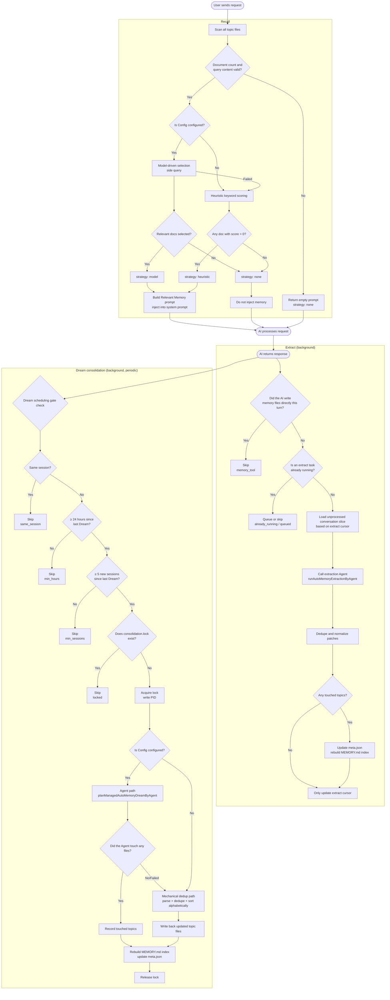
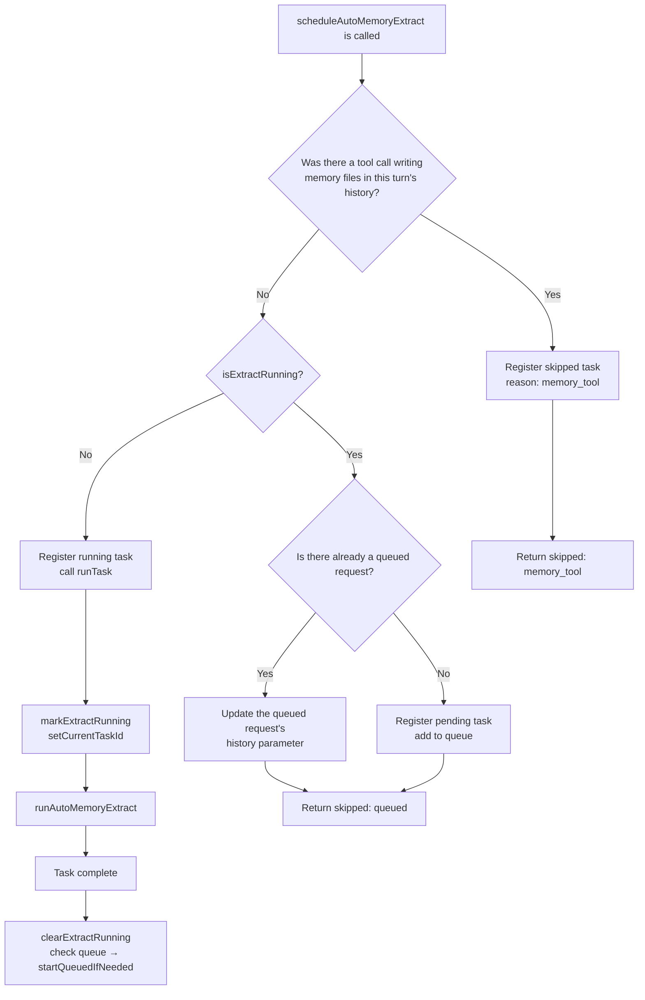
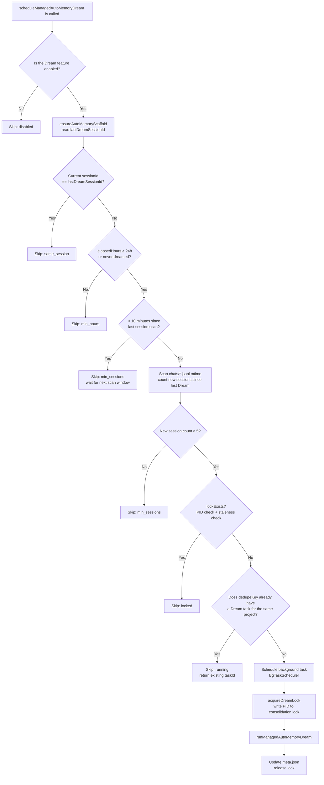
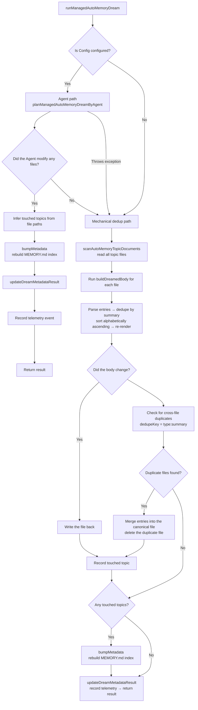
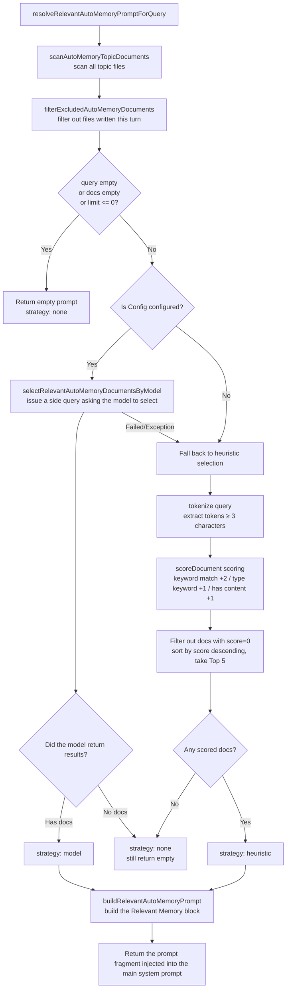
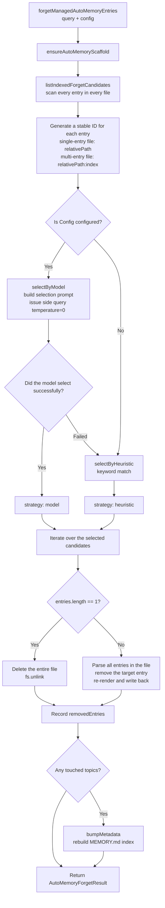

# Memory Management System

> This document describes the memory management mechanism, trigger timing, and implementation details of **Managed Auto-Memory** in Qwen Code.

---

## Table of Contents

1. [Overview](#overview)
2. [Storage Structure](#storage-structure)
3. [Memory Types](#memory-types)
4. [Memory Entry Format](#memory-entry-format)
5. [Core Lifecycle](#core-lifecycle)
6. [Extract](#extract)
7. [Dream](#dream)
8. [Recall](#recall)
9. [Forget](#forget)
10. [Index Rebuild](#index-rebuild)
11. [Telemetry](#telemetry)

---

## Overview

Managed Auto-Memory is a persistent memory system that **automatically** accumulates, consolidates, and retrieves user-relevant knowledge during AI sessions. It maintains the memory lifecycle through four core operations:

| Operation | English | Trigger                         | Purpose                                                                                |
| --------- | ------- | ------------------------------- | -------------------------------------------------------------------------------------- |
| Extract   | Extract | Automatic (after each turn)     | Distills new knowledge from the conversation into memory files                         |
| Dream     | Dream   | Automatic (periodic background) | Deduplicates and merges memory files to keep them tidy                                 |
| Recall    | Recall  | Automatic (before each turn)    | Retrieves memory relevant to the current request and injects it into the system prompt |
| Forget    | Forget  | Manual (user command `/forget`) | Precisely deletes specified memory entries                                             |

---

## Storage Structure

### Directory Layout

```
~/.qwen/                                      ← global base directory (default)
└── projects/
    └── <sanitized-git-root>/                 ← project identifier (based on Git root path)
        ├── meta.json                         ← metadata (extract/consolidation timestamps, status)
        ├── extract-cursor.json               ← extract cursor (processed conversation offset)
        ├── consolidation.lock                ← Dream process mutex lock
        └── memory/                           ← main memory directory
            ├── MEMORY.md                     ← index file (auto-generated, aggregates all entries)
            ├── user.md                       ← user preference memory (example)
            ├── feedback.md                   ← feedback convention memory (example)
            ├── project/
            │   └── milestone.md              ← project memory (subdirectories supported)
            └── reference/
                └── grafana.md                ← external resource memory
```

> **Environment variable overrides**:
>
> - `QWEN_CODE_MEMORY_BASE_DIR`: replaces the global base directory
> - `QWEN_CODE_MEMORY_LOCAL=1`: switches to the in-project path `.qwen/memory/`

### Key File Descriptions

| File                  | Description                                                                                                    |
| --------------------- | -------------------------------------------------------------------------------------------------------------- |
| `meta.json`           | Records the time, session ID, memory types involved, and execution status of the last Extract / Dream          |
| `extract-cursor.json` | Records the conversation-history offset processed so far in the current session, to avoid duplicate extraction |
| `consolidation.lock`  | File lock held while Dream runs; its content is the holder's PID, and it expires automatically after 1 hour    |
| `MEMORY.md`           | Index of all topic files; rebuilt after each Extract/Dream, formatted as a Markdown list                       |

---

## Memory Types

The system supports four built-in memory types, each corresponding to a different information dimension:

| Type        | Stored Content                                                                              | When to Write                                                       | When to Read                                                     |
| ----------- | ------------------------------------------------------------------------------------------- | ------------------------------------------------------------------- | ---------------------------------------------------------------- |
| `user`      | The user's role, skill background, and work habits                                          | When learning the user's role/preferences/knowledge background      | When an answer needs to be tailored to the user's background     |
| `feedback`  | The user's guidance on AI behavior: what to avoid, what to keep doing                       | When the user corrects the AI or confirms some non-obvious practice | When it affects how the AI behaves                               |
| `project`   | Project progress, goals, decisions, deadlines, bug tracking                                 | When learning who is doing what, why, and by when                   | When helping the AI understand work context and motivation       |
| `reference` | Pointers to external system resources (dashboards, ticketing systems, Slack channels, etc.) | When learning about an external resource and its purpose            | When the user mentions an external system or related information |

**What should NOT be stored in memory**: code patterns/conventions, Git history, debugging solutions, transient task state, and anything already recorded in QWEN.md/AGENTS.md.

---

## Memory Entry Format

Each topic file uses the **YAML frontmatter + Markdown body** format:

```markdown
---
name: memory name
description: one-sentence description (used to judge recall relevance; be specific)
type: user|feedback|project|reference
---

memory body content (summary line)

Why: the underlying reason (so the AI can understand edge cases instead of blindly following rules)
How to apply: applicable scenarios and usage
```

For the `feedback` and `project` types, it is strongly recommended to fill in `Why` and `How to apply`, so that the memory can still be applied correctly in edge cases.

---

## Core Lifecycle



---

## Extract

### Trigger Timing

Automatically triggered (non-blocking, in the background) by `scheduleAutoMemoryExtract` after the AI completes each response turn.

### Scheduling Logic (`extractScheduler.ts`)



**Skip reasons**:

| Reason            | Meaning                                                                                  |
| ----------------- | ---------------------------------------------------------------------------------------- |
| `memory_tool`     | The main Agent already wrote memory files directly this turn; skipped to avoid conflicts |
| `already_running` | Extraction is in progress and cannot be queued                                           |
| `queued`          | An extraction is already running, so this request was queued                             |

### Core Extraction Flow (`extract.ts`)

```mermaid
flowchart TD
    A[runAutoMemoryExtract] --> B[ensureAutoMemoryScaffold\ninitialize directories and files]
    B --> C[buildTranscriptMessages\nconvert Content[] into an offset-tagged message list]
    C --> D[readExtractCursor\nread the last processed position]
    D --> E[loadUnprocessedTranscriptSlice\nextract the unprocessed message segment]
    E --> F{Is the slice empty?}
    F -- Yes --> G[Return a result with no patches]
    F -- No --> H[runAutoMemoryExtractionByAgent\ncall the forked agent to extract patches]
    H --> I[dedupeExtractPatches\ndedupe + normalize]
    I --> J{Any touched topics?}
    J -- Yes --> K[bumpMetadata\nupdate meta.json]
    K --> L[rebuildManagedAutoMemoryIndex\nrebuild MEMORY.md]
    L --> M[writeExtractCursor\nrecord the latest offset]
    J -- No --> M
    M --> N[Return AutoMemoryExtractResult]
```

**Extract Cursor**:

- Fields: `{ sessionId, processedOffset, updatedAt }`
- After each extraction, `processedOffset` is updated to the current history length
- On the next extraction, only messages with `offset >= processedOffset` are processed
- Across sessions (when `sessionId` changes), it restarts from offset 0

**Patch Filtering Rules**:

- Summary length < 12 characters → discard
- Summary ends with `?` → discard (question)
- Contains transient keywords (today/now/currently/temporary, etc.) → discard
- Identical `topic:summary` combination → deduplicate

---

## Dream

### Trigger Timing

Automatically triggered (non-blocking, in the background) by `scheduleManagedAutoMemoryDream` after the AI completes each response turn. However, it is protected by several gating conditions and is skipped in most cases.

### Scheduling Gates (`dreamScheduler.ts`)



**Gating Parameters**:

| Parameter                  | Default    | Description                                                  |
| -------------------------- | ---------- | ------------------------------------------------------------ |
| `minHoursBetweenDreams`    | 24 hours   | Minimum time interval between two Dreams                     |
| `minSessionsBetweenDreams` | 5 sessions | Minimum number of new sessions required to trigger a Dream   |
| `SESSION_SCAN_INTERVAL_MS` | 10 minutes | Throttling interval for scanning session files               |
| `DREAM_LOCK_STALE_MS`      | 1 hour     | Time threshold after which the lock file is considered stale |

**Locking Mechanism**:

- The lock file is located at `<project-state-dir>/consolidation.lock`
- Its content is the PID of the holding process
- On check: if the PID's process no longer exists (`kill(pid, 0)` fails) or the lock is older than 1 hour → it is considered stale and cleared automatically

### Consolidation Execution Flow (`dream.ts`)



**Mechanical Dedup Logic**:

1. Within each topic file: deduplicate by `summary.toLowerCase()`, merging the `why`/`howToApply` fields
2. Re-sort by summary in alphabetical order
3. Across files: entries with the same `type:summary` are merged into the first file in which they were found, and the duplicate file is deleted

---

## Recall

### Trigger Timing

Before the AI processes each user request, `resolveRelevantAutoMemoryPromptForQuery` is triggered automatically to inject relevant memory into the system prompt.

### Recall Flow (`recall.ts`)



**Scoring Rules (Heuristic)**:

| Condition                                             | Points         |
| ----------------------------------------------------- | -------------- |
| A query token appears in the document content         | +2 (per token) |
| A query token is a characteristic keyword of the type | +1 (per token) |
| The document body is non-empty                        | +1             |

**Characteristic Keywords per Type**:

- `user`: user, preference, background, role, terse
- `feedback`: feedback, rule, avoid, style, summary
- `project`: project, goal, incident, deadline, release
- `reference`: reference, dashboard, ticket, docs, link

**Prompt Construction Rules**:

- At most 5 documents are injected (`MAX_RELEVANT_DOCS`)
- Each document body is truncated to 1200 characters (`MAX_DOC_BODY_CHARS`)
- When truncated, the note "NOTE: Relevant memory truncated for prompt budget." is appended
- Document freshness information is included (based on file mtime)

---

## Forget

### Trigger Timing

Triggered manually by the user via the `/forget <query>` command.

### Forget Flow (`forget.ts`)



**Entry ID Design**:

- Single-entry file (common case): `relativePath` (e.g., `feedback/no-summary.md`)
- Multi-entry file: `relativePath:index` (e.g., `feedback/style.md:2`)
- Using stable IDs lets the model precisely target an entry without affecting other entries in the same file

---

## Index Rebuild

`MEMORY.md` is the navigation index for all topic files. It is rebuilt by calling `rebuildManagedAutoMemoryIndex` after each Extract or Dream:

```
- [User Preferences](user/preferences.md) — The user is a senior Go engineer encountering React for the first time
- [Feedback Conventions](feedback/style.md) — Keep replies concise, no trailing summaries
- [Project Milestone](project/milestone.md) — Merge freeze window before cutting the mobile release branch
```

**Index Limits**:

- At most 150 characters per line (truncated with `…` if exceeded)
- At most 200 lines
- Total size must not exceed 25,000 bytes

---

## Telemetry

The system has three built-in classes of telemetry events, used to monitor the performance and effectiveness of memory operations:

### Extract Telemetry

| Field            | Type                        | Description                          |
| ---------------- | --------------------------- | ------------------------------------ |
| `trigger`        | `'auto'`                    | Trigger method (currently auto only) |
| `status`         | `'completed'` \| `'failed'` | Execution result                     |
| `patches_count`  | number                      | Number of valid patches extracted    |
| `touched_topics` | string[]                    | List of memory types written         |
| `duration_ms`    | number                      | Total duration (milliseconds)        |

### Dream Telemetry

| Field             | Type                                  | Description                                           |
| ----------------- | ------------------------------------- | ----------------------------------------------------- |
| `trigger`         | `'auto'`                              | Trigger method                                        |
| `status`          | `'updated'` \| `'noop'` \| `'failed'` | Execution result                                      |
| `deduped_entries` | number                                | Number of entries deduplicated on the mechanical path |
| `touched_topics`  | string[]                              | List of memory types modified                         |
| `duration_ms`     | number                                | Total duration (milliseconds)                         |

### Recall Telemetry

| Field           | Type                                   | Description                          |
| --------------- | -------------------------------------- | ------------------------------------ |
| `query_length`  | number                                 | Length of the query string           |
| `docs_scanned`  | number                                 | Total number of documents scanned    |
| `docs_selected` | number                                 | Number of documents finally injected |
| `strategy`      | `'none'` \| `'heuristic'` \| `'model'` | Selection strategy                   |
| `duration_ms`   | number                                 | Total duration (milliseconds)        |

---

## Related Source File Index

| File                                                 | Responsibility                                                                          |
| ---------------------------------------------------- | --------------------------------------------------------------------------------------- |
| `packages/core/src/memory/types.ts`                  | Type definitions: `AutoMemoryType`, `AutoMemoryMetadata`, `AutoMemoryExtractCursor`     |
| `packages/core/src/memory/paths.ts`                  | Path computation: `getAutoMemoryRoot`, `isAutoMemPath`, various file-path helpers       |
| `packages/core/src/memory/store.ts`                  | Scaffold initialization: `ensureAutoMemoryScaffold`, index/metadata read/write          |
| `packages/core/src/memory/scan.ts`                   | Scan topic files: `scanAutoMemoryTopicDocuments`, parse frontmatter                     |
| `packages/core/src/memory/entries.ts`                | Entry parsing and rendering: `parseAutoMemoryEntries`, `renderAutoMemoryBody`           |
| `packages/core/src/memory/extract.ts`                | Core extraction logic: `runAutoMemoryExtract`, cursor management, patch dedup           |
| `packages/core/src/memory/extractScheduler.ts`       | Extraction scheduler: `ManagedAutoMemoryExtractRuntime`, queue/run state machine        |
| `packages/core/src/memory/extractionAgentPlanner.ts` | Extraction Agent: `runAutoMemoryExtractionByAgent`                                      |
| `packages/core/src/memory/dream.ts`                  | Core consolidation logic: `runManagedAutoMemoryDream`, Agent path + mechanical dedup    |
| `packages/core/src/memory/dreamScheduler.ts`         | Consolidation scheduler: `ManagedAutoMemoryDreamRuntime`, gate checks, lock management  |
| `packages/core/src/memory/dreamAgentPlanner.ts`      | Consolidation Agent: `planManagedAutoMemoryDreamByAgent`                                |
| `packages/core/src/memory/recall.ts`                 | Recall logic: `resolveRelevantAutoMemoryPromptForQuery`, heuristic + model dual paths   |
| `packages/core/src/memory/forget.ts`                 | Forget logic: `forgetManagedAutoMemoryEntries`, candidate generation + precise deletion |
| `packages/core/src/memory/indexer.ts`                | Index rebuild: `rebuildManagedAutoMemoryIndex`, `buildManagedAutoMemoryIndex`           |
| `packages/core/src/memory/prompt.ts`                 | System prompt templates: memory type descriptions, format examples, usage conventions   |
| `packages/core/src/memory/governance.ts`             | Governance suggestion types: `AutoMemoryGovernanceSuggestionType`                       |
| `packages/core/src/memory/state.ts`                  | Extraction run state: `isExtractRunning`, `markExtractRunning`, `clearExtractRunning`   |
| `packages/core/src/memory/memoryAge.ts`              | Freshness description: `memoryAge`, `memoryFreshnessText`                               |
