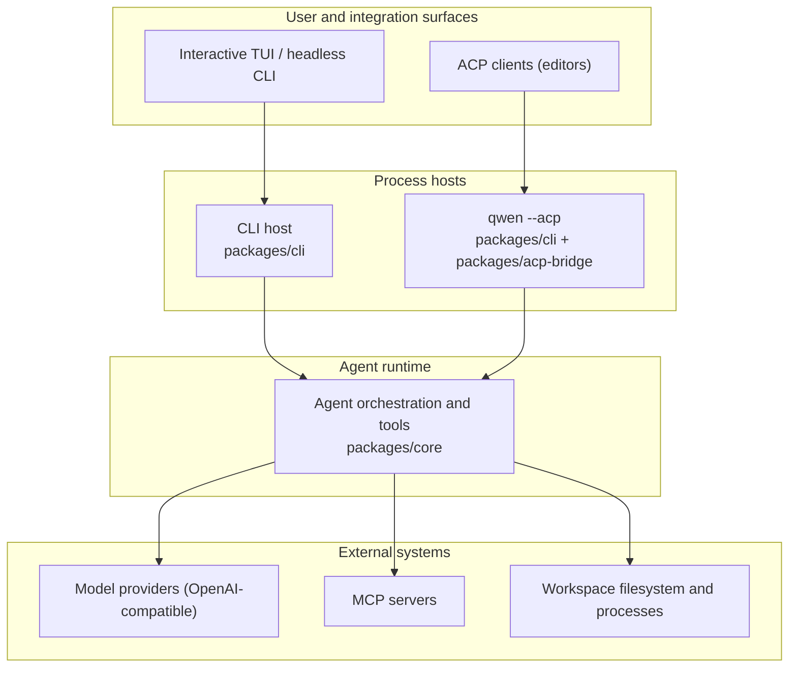

# Qwen Coder Minimal Architecture Overview

Qwen Coder Minimal is a monorepo with three packages. It supports an
interactive terminal, headless execution, and the Agent Client Protocol (ACP)
over stdio. This document maps those surfaces to the packages that implement
them and explains the main runtime boundaries.

## System at a glance

Qwen Coder Minimal has two agent execution models:

- **Direct execution:** the interactive TUI and headless CLI construct and run
  the agent runtime directly.
- **ACP execution:** `qwen --acp` hosts the agent behind an ACP transport over
  stdio, driven by an editor or another ACP client.

## Repository layout

| Path                   | Responsibility                                                                                                   |
| ---------------------- | ---------------------------------------------------------------------------------------------------------------- |
| `packages/cli`         | The `qwen` executable: argument parsing, settings, the Ink/OpenTUI terminal UI, headless mode, and the ACP host. |
| `packages/core`        | UI-independent agent runtime: model requests, context, tools, permissions, memory, skills.                       |
| `packages/acp-bridge`  | ACP session plumbing shared by the CLI's ACP host: channel spawning, permission mediation, session events.       |
| `integration-tests`    | End-to-end tests that run the bundled CLI, against a fake OpenAI server or a real model.                         |
| `docs` and `docs-site` | User and developer documentation.                                                                                |
| `scripts`              | Build, bundle, packaging, and repository tooling.                                                                |

Packages depend on each other through their declared public exports rather than
through a relative path into another package's source tree.

## Package boundaries

### CLI and presentation

`packages/cli` owns the executable and chooses the runtime mode from
command-line arguments. It loads user and workspace settings, constructs the
core configuration, enters the requested sandbox when necessary, and then
starts the interactive, headless, or ACP flow. The terminal UI renders local
interactive sessions; headless mode serializes the same events as text, JSON,
or stream-JSON.

### Core runtime

`packages/core` owns the agent loop. It constructs model requests, maintains
conversation context, dispatches tool calls, applies permission policy, and
returns structured events and results to the active host. Built-in tools cover
file operations, shell execution, search, planning, web access, memory, skills,
and subagents. MCP extends the tool and resource surface without coupling the
runtime to a specific integration.

The core package does not decide how results are displayed; that belongs to
the CLI.

### ACP bridge

`packages/acp-bridge` provides the ACP plumbing the CLI's ACP host uses:
multiplexing sessions, forwarding prompts, cancellations and notifications,
mediating permission requests, and publishing bounded session event streams.
See the [`@qwen-code/acp-bridge` README](../../packages/acp-bridge/README.md)
for its public entry points.

## Runtime flows

### Direct CLI flow

1. The CLI parses arguments and resolves user, workspace, environment, and
   command-line configuration.
2. It prepares sandboxing and constructs the core runtime configuration.
3. The core runtime builds the model request and enters the agent/tool loop.
4. Tool calls are checked against permission policy and executed in the active
   workspace environment.
5. The CLI renders incremental events in the TUI or serializes them for
   headless output.

### ACP flow

1. An ACP client starts `qwen --acp` and speaks ACP over stdio.
2. The CLI's ACP host creates sessions and forwards prompts to the same core
   agent and tool logic used by direct execution.
3. Permission requests and session updates return to the client over the same
   ACP connection.

## Extension points

- **MCP servers** add tools, prompts, and resources to the core runtime.
- **Extensions and skills** package reusable commands, configuration, and agent
  behavior.
- **Hooks** run user commands around tool calls and session events.

Shared agent behavior belongs in the core runtime; presentation and transport
belong in the CLI.

## Configuration and state

The CLI assembles effective configuration from command-line arguments,
environment variables, user settings, workspace settings, and defaults before
constructing the runtime. The core receives the resolved configuration rather
than reading presentation-specific input. See
[Settings](../users/configuration/settings.md) for the supported settings and
their scopes. Sessions persist their history and metadata through shared core
services.

## Where to go next

- [ACP bridge](../../packages/acp-bridge/README.md)
- [Tool development](./tools/introduction.md)
- [Integration testing](./development/integration-tests.md)
